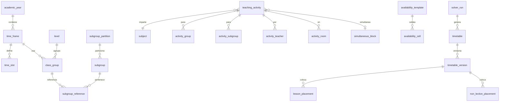

# 02 — Plan de arquitectura

> **Estado:** Borrador · **Versión:** 0.1 · **Última actualización:** 2026-11-22

Este documento define **cómo** se construye lo especificado en [`01-domain-spec.md`](01-domain-spec.md),
dentro de las reglas de [`CLAUDE.md`](../CLAUDE.md). No contiene código de aplicación. Los fragmentos de
esquema y JSON son parte de la especificación.

Si este plan contradice a la spec 01, **manda la 01**. Las discrepancias detectadas al redactar este plan
se recogen en la sección 8.

---

## Índice

1. [Estructura del monorepo](#1-estructura-del-monorepo)
2. [Modelo de datos relacional (PostgreSQL)](#2-modelo-de-datos-relacional-postgresql)
3. [Contrato JSON web ↔ solver (v1)](#3-contrato-json-web--solver-v1)
4. [Modelo matemático CP-SAT](#4-modelo-matemático-cp-sat)
5. [Arquitectura de seguridad](#5-arquitectura-de-seguridad)
6. [Diseño UX/UI](#6-diseño-uxui)
7. [Decisiones de arquitectura y ADR pendientes](#7-decisiones-de-arquitectura-y-adr-pendientes)
8. [Ajustes propuestos a la spec 01](#8-ajustes-propuestos-a-la-spec-01)

---

## 1. Estructura del monorepo

### 1.1 Raíz

```
/
├── apps/web/                    # Next.js: UI + BFF + dueño del esquema de BD
├── services/solver/             # FastAPI + OR-Tools: Fase A, Fase B, Fase C y comprobador
├── specs/                       # Fuente de verdad (01-domain-spec.md, 02-architecture-plan.md, …)
├── docs/
│   ├── adr/                     # NNNN-titulo.md
│   ├── diagrams/                # C4, secuencia, ER (Mermaid / PlantUML)
│   └── defensa/                 # Material para la defensa del TFM
├── .github/workflows/ci.yml     # Lint, tipos, tests, contrato, build de imágenes
├── docker-compose.yml           # db + web + solver
├── .env.example                 # Todas las variables, documentadas (sección 5.7)
├── .editorconfig
├── .gitignore
├── package.json                 # Scripts orquestadores (dev, test, lint) del workspace
├── pnpm-workspace.yaml          # Workspaces: apps/*
├── CLAUDE.md
└── README.md                    # Arranque rápido + credenciales demo (TFM-01)
```

- Gestor de paquetes JS: **pnpm** (workspaces). Gestor Python: **uv**.
- No se usa un orquestador de monorepo adicional (Turborepo, Nx): hay solo una app JS y un servicio
  Python, y los scripts raíz bastan.

### 1.2 `apps/web`

```
apps/web/
├── package.json
├── tsconfig.json                # strict, noUncheckedIndexedAccess, noImplicitOverride
├── next.config.ts
├── postcss.config.mjs
├── components.json              # Configuración de shadcn/ui
├── eslint.config.mjs
├── vitest.config.ts
├── playwright.config.ts
├── Dockerfile                   # Multi-stage, salida standalone, usuario no root
├── prisma/
│   ├── schema.prisma
│   ├── migrations/              # Migraciones versionadas (+ SQL manual: EXCLUDE, índices parciales)
│   └── seed/
│       ├── index.ts             # Punto de entrada del seed
│       ├── production-guard.ts  # Aborta si APP_ENV=production (TFM-02)
│       └── demo-school/
│           ├── users.ts
│           ├── time-frames.ts
│           ├── academic.ts      # Departamentos, materias, profesores, grupos, subgrupos, aulas
│           ├── activities.ts    # Actividades, bloques, optativas, prefijadas
│           ├── non-lective.ts   # Guardias, reuniones, reducciones
│           └── availability.ts  # Plantillas con los 4 estados
├── e2e/
│   ├── auth.spec.ts
│   ├── rbac.spec.ts
│   ├── engine-flow.spec.ts      # Login → validar → calcular → comparar → vigente → ver
│   ├── editor.spec.ts
│   ├── perspectives.spec.ts     # VIS-02 (< 200 ms)
│   └── fixtures/
└── src/
    ├── proxy.ts                 # Cabeceras + CSP nonce + redirección gruesa (sección 5.3; el antiguo middleware.ts)
    ├── app/                     # SOLO UI y adaptadores de entrada
    │   ├── layout.tsx
    │   ├── globals.css          # Tokens de diseño (sección 6.2)
    │   ├── (public)/login/
    │   │   ├── page.tsx
    │   │   └── actions.ts
    │   ├── (app)/
    │   │   ├── layout.tsx       # Sidebar + barra superior + banner demo
    │   │   ├── page.tsx         # Panel de inicio
    │   │   ├── configuracion/
    │   │   │   ├── curso/
    │   │   │   ├── marcos/ y marcos/[frameId]/
    │   │   │   ├── caracteristicas/        # RG-02
    │   │   │   └── pesos/                  # Pesos RB por defecto
    │   │   ├── datos/
    │   │   │   ├── departamentos/  materias/  profesores/  aulas/
    │   │   │   ├── grupos/ y grupos/[groupId]/subgrupos/
    │   │   │   ├── actividades/            # Incluye asistente de tutoría
    │   │   │   ├── bloques/                # Simultáneos y conjuntos de optativas
    │   │   │   └── plantillas/[ownerType]/[ownerId]/
    │   │   ├── no-lectiva/
    │   │   │   ├── guardias/  reuniones/  reducciones/
    │   │   ├── motor/
    │   │   │   ├── page.tsx                # Pre-validación + lanzar
    │   │   │   ├── ejecuciones/[runId]/    # Progreso
    │   │   │   └── ejecuciones/[runId]/comparar/
    │   │   ├── horarios/
    │   │   │   ├── page.tsx
    │   │   │   └── [timetableId]/ (page.tsx, editor/, versiones/)
    │   │   ├── mi-horario/
    │   │   ├── mis-preferencias/
    │   │   ├── importar-exportar/
    │   │   └── administracion/usuarios/
    │   │   (cada ruta con mutaciones tiene su actions.ts: Server Actions finas)
    │   └── api/
    │       ├── auth/logout/route.ts
    │       ├── runs/[runId]/route.ts           # Estado de ejecución (polling)
    │       └── export/[timetableId]/[format]/route.ts
    ├── domain/                  # TS puro: sin Next, Prisma ni fetch
    │   ├── shared/              # ids, Result, errores de dominio
    │   ├── time/                # MinuteOfDay, Quarters, Interval, overlap
    │   ├── time-frame/          # TimeFrame, TimeSlot, contiguous-spans (MH-04), INV-01/02
    │   ├── availability/        # CellState, combinación de plantillas (MH-06)
    │   ├── academic/            # Teacher, ClassGroup, Subgroup, Subject, Room, Department,
    │   │                        # TeachingActivity, SimultaneousBlock, reglas ENT-*
    │   ├── non-lective/         # DutyService, Meeting, Reduction
    │   ├── scope-settings/      # Resolución de características por ámbito (RG-02)
    │   ├── tutor-wizard/        # Cálculo de horas restantes y propuesta (ENT-03)
    │   ├── timetable/           # Timetable, Placement, OccupancyMap, MoveDiagnostics (EDI-03)
    │   └── access/              # Role, Permission, AccessPolicy (matriz de 01 §9)
    ├── application/             # Casos de uso + puertos
    │   ├── ports/               # *Repository, SolverGateway, PasswordHasher, SessionStore,
    │   │                        # RateLimiter, Clock, AuditLog, Exporter, Importer
    │   ├── auth/  configuration/  academic/  non-lective/  availability/
    │   ├── engine/              # build-solver-input, prevalidate, launch-run, poll-run,
    │   │                        # cancel-run, select-current-result
    │   ├── timetable/           # move-session, swap-sessions, lock-session, save-version
    │   └── io/                  # import-data (simulación + aplicación), export-timetable
    ├── infrastructure/
    │   ├── db/                  # prisma-client.ts, repositories/*.ts, mappers/*.ts
    │   ├── solver/              # http-solver-gateway.ts, contract.ts (Zod v1)
    │   ├── auth/                # argon2-hasher.ts, pg-session-store.ts, cookies.ts, guards.ts
    │   ├── security/            # pg-rate-limiter.ts, csp.ts, security-headers.ts, origin-check.ts
    │   ├── export/              # pdf/, xlsx.ts, csv.ts (anti formula injection), json.ts
    │   └── import/              # csv-reader.ts, json-reader.ts
    ├── ui/
    │   ├── components/ui/       # Generados por shadcn/ui
    │   ├── layout/              # app-sidebar, topbar, demo-banner, theme-toggle
    │   ├── timetable/           # timetable-grid, session-card, perspective-switcher,
    │   │                        # drop-feedback, slot-band, legend
    │   ├── engine/              # run-progress, prevalidation-report, results-comparison
    │   └── forms/
    └── lib/                     # env.ts (Zod), query-client.ts, i18n/es.ts
```

- **Tests unitarios** junto al código (`*.test.ts` / `*.test.tsx`), con Vitest + React Testing Library.
- **Dependencias permitidas entre capas** (se comprueban con una regla de lint `no-restricted-imports`):
  `domain` → nada; `application` → `domain`; `infrastructure` → `application`, `domain`;
  `app`/`ui` → `application`, `domain` (solo tipos y funciones puras). `app` y `ui` NO importan `infrastructure`,
  salvo el *composition root* `src/lib/container.ts`, que instancia los adaptadores.

### 1.3 `services/solver`

```
services/solver/
├── pyproject.toml               # ruff, mypy --strict, pytest, cobertura
├── uv.lock
├── Dockerfile                   # python:3.12-slim, usuario no root, FS de solo lectura
├── schemas/                     # JSON Schema GENERADO desde Pydantic (se versiona en git)
│   ├── solver-input.v1.json
│   └── solver-output.v1.json
├── src/solver/
│   ├── api/
│   │   ├── app.py               # Fábrica FastAPI, límites de tamaño, handlers de error
│   │   ├── routes.py            # /v1/validate, /v1/jobs, /v1/check, /health
│   │   ├── auth.py              # Token de servicio (compare_digest)
│   │   └── jobs.py              # Registro de trabajos en memoria + pool de procesos
│   ├── contract/
│   │   ├── input.py             # SolverInput (Pydantic v2, extra=forbid, frozen)
│   │   ├── output.py            # SolverOutput
│   │   ├── validators.py        # Integridad referencial e invariantes del contrato
│   │   └── export_schema.py     # Genera schemas/*.json
│   ├── domain/
│   │   ├── problem.py           # Problema normalizado (índices enteros)
│   │   ├── spans.py             # Arranques candidatos y tramos ocupados (MH-04)
│   │   ├── overlap.py           # Puntos de solapamiento por día (sección 4.3)
│   │   └── conflict_groups.py   # Reglas de grupo/subgrupo/partición (ENT-05)
│   ├── prevalidation/           # Fase A: un módulo por regla
│   │   ├── pv01_group_hours.py … pv12_broken_refs.py
│   │   └── runner.py
│   ├── model/                   # Fase B
│   │   ├── builder.py           # Orquesta variables + restricciones + objetivo
│   │   ├── variables.py
│   │   ├── hard/                # rd01_all_placed.py … rd14_equivalent_teachers.py
│   │   └── soft/                # rb01_teacher_gaps.py … rb06_preferred_room.py
│   ├── search/                  # Fase C
│   │   ├── multi_solution.py
│   │   ├── progress_callback.py
│   │   ├── metrics.py           # MR-03
│   │   └── diagnostics.py       # Núcleo de infactibilidad (6.2.3)
│   └── verification/
│       └── checker.py           # Comprobador independiente de RD (RB-CA-02, EDI-06)
└── tests/
    ├── unit/
    │   ├── prevalidation/  hard/  soft/  search/  verification/  domain/
    ├── contract/                # Validación de fixtures contra schemas/*.json
    ├── integration/             # API completa con TestClient
    └── fixtures/
        ├── shared/              # Casos compartidos con apps/web (paridad de reglas)
        └── demo_school.json     # SolverInput del seed (rendimiento TFM-01-CA-02)
```

- **Paridad web ↔ solver**: los fixtures de `tests/fixtures/shared/` describen casos de movimiento
  válidos e inválidos. Se ejecutan en pytest (contra `checker.py`) y en Vitest (contra
  `domain/timetable/move-diagnostics.ts`), y ambos deben dar el mismo veredicto.
- **Sincronía del contrato**: CI regenera `schemas/*.json` y falla si difieren de lo versionado. En web,
  un test valida con Ajv los fixtures que produce Zod contra esos JSON Schema.

### 1.4 `docker-compose.yml` (diseño)

| Servicio | Imagen | Redes | Puertos publicados | Notas |
|----------|--------|-------|--------------------|-------|
| `db` | `postgres:16-alpine` | `backend` | Ninguno (en desarrollo, `5432` solo en `127.0.0.1`) | Volumen `pgdata`, healthcheck `pg_isready` |
| `solver` | build `services/solver` | `solver_net` (internal) | **Ninguno** | `read_only: true`, `tmpfs /tmp`, límites de CPU y memoria, usuario no root |
| `web` | build `apps/web` | `backend`, `solver_net`, `public` | `3000`, solo en `127.0.0.1` (en local va por HTTP; en producción la expone el proxy inverso del H6) | Ejecuta `prisma migrate deploy` al arrancar; seed opcional con `SEED_ON_START=true` (nunca en producción) |

- `solver_net` y `backend` se declaran con `internal: true`: no tienen salida a Internet.
- El solver **no comparte red con `db`**, así que no puede llegar a la base de datos.

---

## 2. Modelo de datos relacional (PostgreSQL)

### 2.1 Convenciones

- PostgreSQL **16**. Extensiones: `citext`, `btree_gist`.
- Las claves primarias son `uuid` (v7, generadas en la aplicación), así que son ordenables por tiempo.
- Todas las tablas tienen `created_at timestamptz not null default now()` y `updated_at timestamptz`. Se
  omiten en las tablas de abajo.
- Nombres de tabla y columna en `snake_case` inglés. En Prisma, modelos en PascalCase con `@@map`.
- **Ámbito**: casi todas las tablas académicas tienen `academic_year_id` (FK, `ON DELETE CASCADE`).
- **Claves externas de integración** (IO-01): columna `external_key text null`, con índice único parcial
  `UNIQUE (academic_year_id, external_key) WHERE external_key IS NOT NULL`. Aparece como `ext` en las tablas.
- **Abreviaturas**: `UNIQUE (academic_year_id, abbreviation)` (INV-03).
- **Horas reales**: `smallint` en **minutos desde medianoche** (`0..1440`). **Duraciones lectivas**:
  `smallint` en **cuartos de tramo** (`1/2 = 2`, `3/4 = 3`, `1 = 4`, `1.5 = 6`, `2 = 8`, `3 = 12`).
- **Cargas de profesor**: en **minutos reales**, porque un profesor puede trabajar en marcos con unidades
  de tramo distintas.
- **Referencias polimórficas** (plantillas, ámbitos): columnas FK separadas y nulas, con
  `CHECK (num_nonnulls(...) = 1)` (o `<= 1`). Así se conserva la integridad referencial.
- Las restricciones que Prisma no expresa (EXCLUDE, índices parciales, CHECK) se añaden en SQL dentro de
  la migración correspondiente.

### 2.2 Identidad, sesiones y auditoría

| Tabla | Columnas | Restricciones e índices |
|-------|----------|--------------------------|
| `app_user` | `id`, `email citext`, `password_hash text`, `display_name text`, `role user_role`, `is_active bool`, `failed_login_count smallint`, `locked_until timestamptz null`, `last_login_at timestamptz null` | `UNIQUE(email)` |
| `user_session` | `id`, `user_id → app_user`, `token_hash bytea` (SHA-256), `expires_at`, `idle_expires_at`, `ip inet`, `user_agent text` | `UNIQUE(token_hash)`, `INDEX(user_id)`, `INDEX(expires_at)`; `ON DELETE CASCADE` |
| `rate_limit_bucket` | `key text`, `window_start timestamptz`, `count int` | `PK(key, window_start)` |
| `audit_log` | `id`, `user_id → app_user null`, `action text`, `entity_type text`, `entity_id uuid null`, `metadata jsonb`, `at timestamptz` | `INDEX(entity_type, entity_id)`, `INDEX(at)` |

`user_role` = `ADMIN_DIRECCION | DOCENTE | INVITADO_DEMO`.

### 2.3 Centro, curso y ámbitos

| Tabla | Columnas | Restricciones e índices |
|-------|----------|--------------------------|
| `school` | `id`, `name`, `timezone text` | Una fila (P-01) |
| `academic_year` | `id`, `school_id → school`, `name` (`2026-2027`), `starts_on date`, `ends_on date`, `is_current bool`, `cloned_from_id → academic_year null` | `UNIQUE(school_id, name)`; índice único parcial `(school_id) WHERE is_current` |
| `level` | `id`, `academic_year_id`, `stage stage`, `name`, `sort_order smallint` | `UNIQUE(academic_year_id, stage, name)` |
| `feature_setting` | `id`, `academic_year_id`, `time_frame_id null`, `level_id null`, `class_group_id null`, `feature_key text`, `enabled bool` | `CHECK(num_nonnulls(time_frame_id, level_id, class_group_id) <= 1)` (todas nulas = ámbito Centro); `UNIQUE NULLS NOT DISTINCT (academic_year_id, time_frame_id, level_id, class_group_id, feature_key)` |
| `soft_constraint_weight` | `academic_year_id`, `code rb_code`, `weight smallint` | `PK(academic_year_id, code)`; `CHECK(weight BETWEEN 0 AND 100)` |

`stage` = `INFANTIL | PRIMARIA | ESO | BACHILLERATO`. `rb_code` = `RB01 … RB06`.
El catálogo de `feature_key` se define como constante en `domain/scope-settings` (no se crea una tabla).

### 2.4 Marcos horarios y disponibilidad

| Tabla | Columnas | Restricciones e índices |
|-------|----------|--------------------------|
| `time_frame` | `id`, `academic_year_id`, `name`, `unit_minutes smallint` | `UNIQUE(academic_year_id, name)`; `CHECK(unit_minutes > 0)` |
| `time_slot` | `id`, `time_frame_id`, `weekday smallint` (1 = lunes … 7), `position smallint`, `start_minute smallint`, `end_minute smallint`, `kind slot_kind`, `duration_quarters smallint null` | `UNIQUE(time_frame_id, weekday, position)`; `CHECK(end_minute > start_minute)`; `CHECK((kind = 'TEACHING') = (duration_quarters IS NOT NULL))`; `CHECK(duration_quarters IN (2,3,4))`; **`EXCLUDE USING gist (time_frame_id WITH =, weekday WITH =, int4range(start_minute, end_minute) WITH &&)`** (INV-02) |
| `time_slot_overlap` | `slot_a_id → time_slot`, `slot_b_id → time_slot` | `PK(slot_a_id, slot_b_id)`; `CHECK(slot_a_id < slot_b_id)`. Es una matriz MH-02 materializada que recalcula el caso de uso al cambiar tramos. |
| `availability_template` | `id`, `academic_year_id`, `time_frame_id`, `owner_school bool`, `class_group_id null`, `teacher_id null`, `room_id null`, `subject_id null` | `CHECK(num_nonnulls(NULLIF(owner_school,false), class_group_id, teacher_id, room_id, subject_id) = 1)`; `UNIQUE NULLS NOT DISTINCT (time_frame_id, owner_school, class_group_id, teacher_id, room_id, subject_id)` |
| `availability_cell` | `template_id`, `time_slot_id`, `state cell_state` | `PK(template_id, time_slot_id)`. Almacenamiento disperso: si no hay fila, la celda está `DISPONIBLE`. |
| `availability_request` | `id`, `teacher_id`, `time_slot_id`, `reason text`, `status request_status`, `decided_by → app_user null`, `decided_at null` | `INDEX(teacher_id, status)` (P-03) |

`slot_kind` = `TEACHING | BREAK | LUNCH`. `cell_state` = `FORBIDDEN | PREFERRED | NOT_PREFERRED`.
INV-01 (`end − start = duration × unit / 4`) depende de dos tablas: se valida en el dominio y con un
trigger `BEFORE INSERT OR UPDATE` en `time_slot`.

### 2.5 Entidades académicas

| Tabla | Columnas | Restricciones e índices |
|-------|----------|--------------------------|
| `department` | `id`, `academic_year_id`, `name`, `abbreviation`, `head_teacher_id → teacher null`, `ext` | Únicos estándar |
| `room_type` | `id`, `academic_year_id`, `code`, `name` | `UNIQUE(academic_year_id, code)` |
| `room` | `id`, `academic_year_id`, `name`, `abbreviation`, `room_type_id`, `capacity smallint`, `ext` | Únicos estándar; `CHECK(capacity >= 0)` |
| `subject` | `id`, `academic_year_id`, `department_id null`, `name`, `abbreviation`, `color char(7)`, `required_room_type_id null`, `ext` | Únicos estándar; `CHECK(color ~ '^#[0-9A-Fa-f]{6}$')` |
| `teacher` | `id`, `academic_year_id`, `user_id → app_user null`, `full_name`, `abbreviation`, `max_teaching_minutes_week int`, `max_complementary_minutes_week int`, `max_teaching_minutes_day int null`, `ext` | Únicos estándar; `UNIQUE(academic_year_id, user_id)` |
| `teacher_department` | `teacher_id`, `department_id` | `PK(teacher_id, department_id)` |
| `class_group` | `id`, `academic_year_id`, `level_id`, `time_frame_id`, `name`, `abbreviation`, `student_count smallint`, `home_room_id → room null`, `tutor_teacher_id → teacher null`, `target_weekly_quarters smallint`, `ext` | Únicos estándar; `INDEX(time_frame_id)` |
| `subgroup_partition` | `id`, `academic_year_id`, `name` | `UNIQUE(academic_year_id, name)` |
| `subgroup` | `id`, `partition_id`, `name`, `abbreviation`, `student_count smallint`, `ext` | Únicos estándar |
| `subgroup_reference` | `subgroup_id`, `class_group_id` | `PK(subgroup_id, class_group_id)`; `INDEX(class_group_id)` |
| `simultaneous_block` | `id`, `academic_year_id`, `name`, `kind block_kind` | `kind` = `EXPLICIT \| ELECTIVE_SET` |
| `elective_set_group` | `block_id`, `class_group_id` | `PK(block_id, class_group_id)`. Grupos participantes (ENT-04b). |
| `block_incompatibility` | `block_a_id`, `block_b_id` | `PK`, `CHECK(block_a_id < block_b_id)` |
| `teaching_activity` | `id`, `academic_year_id`, `subject_id`, `time_frame_id`, `session_quarters smallint`, `sessions_per_week smallint`, `teacher_mode teacher_mode`, `same_teacher_all_sessions bool default true`, `room_mode room_mode`, `distribution_mode distribution_mode`, `distribution_mandatory bool`, `simultaneous_block_id null`, `origin activity_origin`, `ext` | `CHECK(session_quarters IN (2,3,4,6,8,12))`; `CHECK(sessions_per_week BETWEEN 1 AND 30)`; `INDEX(simultaneous_block_id)`. `time_frame_id` está desnormalizado para aplicar INV-04. |
| `activity_group` | `activity_id`, `class_group_id` | `PK`; `INDEX(class_group_id)` |
| `activity_subgroup` | `activity_id`, `subgroup_id` | `PK`; `INDEX(subgroup_id)` |
| `activity_teacher` | `activity_id`, `teacher_id` | `PK`; `INDEX(teacher_id)`. Con `teacher_mode = FIXED` imparten todos (codocencia); con `EQUIVALENT_POOL` se elige uno (ENT-06). |
| `activity_room` | `activity_id`, `room_id`, `priority smallint` | `PK(activity_id, room_id)`. `FIXED`: 1 fila; `PREFERRED_WITH_ALTERNATIVES`: prioridad 0 para la preferente y 1..n para las alternativas; `POOL`: todas con 0. |
| `fixed_position` | `id`, `activity_id`, `start_slot_id → time_slot`, `room_id null`, `teacher_id null` | `UNIQUE(activity_id, start_slot_id)` |

`teacher_mode` = `FIXED | EQUIVALENT_POOL`. `room_mode` = `NONE | FIXED | PREFERRED_WITH_ALTERNATIVES | POOL`.
`distribution_mode` = `NONE | DISTINCT_DAYS | NON_CONSECUTIVE_DAYS | CONSECUTIVE_DAYS`.
`activity_origin` = `MANUAL | TUTOR_WIZARD | IMPORT`.
Si `room_mode = FIXED` y no hay fila en `activity_room`, el caso de uso `build-solver-input` toma
`home_room_id` del grupo (ENT-02).

### 2.6 Actividad no lectiva

| Tabla | Columnas | Restricciones e índices |
|-------|----------|--------------------------|
| `duty_service` | `id`, `academic_year_id`, `name`, `kind duty_kind`, `min_per_slot smallint default 0`, `max_per_slot smallint`, `counts_as load_kind default 'COMPLEMENTARY'`, `ext` | `CHECK(0 <= min_per_slot AND min_per_slot <= max_per_slot)` |
| `duty_window` | `duty_service_id`, `time_slot_id` | `PK` |
| `duty_assignment` | `duty_service_id`, `teacher_id`, `weekly_quota smallint` | `PK(duty_service_id, teacher_id)`; `CHECK(weekly_quota >= 0)` |
| `meeting` | `id`, `academic_year_id`, `name`, `kind meeting_kind`, `frequency_per_week smallint`, `duration_slots smallint`, `participant_mode participant_mode`, `department_id null`, `class_group_id null`, `ext` | `CHECK(duration_slots IN (1,2))`; `CHECK` de coherencia entre `participant_mode` y la FK |
| `meeting_participant` | `meeting_id`, `teacher_id` | `PK`. Solo si `participant_mode = EXPLICIT`. |
| `meeting_window` | `meeting_id`, `time_slot_id` | `PK` |
| `teacher_reduction` | `id`, `teacher_id`, `kind text`, `sessions_per_week smallint`, `counts_as load_kind`, `placement_mode placement_mode`, `time_frame_id` | — |
| `reduction_slot` | `reduction_id`, `time_slot_id`, `role slot_role` | `PK(reduction_id, time_slot_id)`. `slot_role` = `FIXED \| WINDOW`. |

`duty_kind` = `CLASSROOM | BREAK | LIBRARY | OTHER`. `meeting_kind` = `DEPARTMENT | CYCLE | TEACHING_TEAM | OTHER`.
`participant_mode` = `EXPLICIT | DEPARTMENT | GROUP_TEAM`. `load_kind` = `TEACHING | COMPLEMENTARY`.

### 2.7 Motor, resultados y horarios

| Tabla | Columnas | Restricciones e índices |
|-------|----------|--------------------------|
| `solver_run` | `id`, `academic_year_id`, `requested_by → app_user`, `status run_status`, `params jsonb`, `input_snapshot jsonb`, `input_sha256 char(64)`, `solver_job_id text null`, `prevalidation jsonb null`, `diagnostics jsonb null`, `started_at`, `finished_at null`, `error_code text null` | `INDEX(academic_year_id, created_at desc)`; índice único parcial `(academic_year_id) WHERE status IN ('QUEUED','VALIDATING','SOLVING')` (máx. 1 ejecución activa por curso) |
| `timetable` | `id`, `academic_year_id`, `solver_run_id null`, `rank smallint null`, `name` (`Resultado 1`…), `status timetable_status`, `objective_value bigint null`, `normalized_score numeric(5,2) null`, `metrics jsonb null` | Índice único parcial `(academic_year_id) WHERE status = 'CURRENT'` (MR-04) |
| `timetable_version` | `id`, `timetable_id`, `version int`, `created_by → app_user null`, `note text null` | `UNIQUE(timetable_id, version)` (EDI-05) |
| `lesson_placement` | `id`, `version_id`, `activity_id`, `session_index smallint`, `start_slot_id → time_slot`, `teacher_id → teacher null`, `room_id → room null`, `locked bool` | `UNIQUE(version_id, activity_id, session_index)`; `INDEX(version_id, teacher_id)`, `INDEX(version_id, room_id)`, `INDEX(version_id, start_slot_id)` |
| `non_lective_placement` | `id`, `version_id`, `kind nl_kind`, `duty_service_id null`, `meeting_id null`, `reduction_id null`, `occurrence_index smallint`, `teacher_id null`, `start_slot_id` | `CHECK(num_nonnulls(duty_service_id, meeting_id, reduction_id) = 1)`; `INDEX(version_id, teacher_id)` |
| `import_job` | `id`, `academic_year_id`, `created_by`, `format io_format`, `entity_type text`, `status import_status`, `file_sha256 char(64)`, `report jsonb` | `INDEX(academic_year_id, created_at desc)` |

`run_status` = `QUEUED | VALIDATING | SOLVING | COMPLETED | NO_SOLUTION | CANCELLED | ERROR` (CU-01).
`timetable_status` = `CANDIDATE | CURRENT | ARCHIVED`. `import_status` = `SIMULATED | APPLIED | FAILED`.

- Cada resultado de la Fase C crea un `timetable` (`CANDIDATE`) con su `timetable_version` 1. Elegir el
  vigente cambia su estado a `CURRENT` y archiva el anterior, en una sola transacción.
- Los tramos que ocupa una sesión no se almacenan: se derivan de `start_slot_id` y de `session_quarters`
  (son únicos, por MH-04).
- `input_snapshot` garantiza que una ejecución no cambia si se editan los datos después (6.0 de la spec 01).

### 2.8 Diagrama ER (resumen)



---

## 3. Contrato JSON web ↔ solver (v1)

### 3.1 Principios

- `schemaVersion` con SemVer. Un cambio incompatible incrementa la versión mayor y la ruta (`/v2/...`).
- **Solo identificadores opacos y números** (RG-05). Los mensajes legibles los compone la web con los
  nombres reales.
- **Tiempo**: `startMinute` y `endMinute` en minutos desde medianoche (`0..1440`), intervalo `[start, end)`,
  y `weekday` de 1 a 7. Con esto se resuelven los **solapamientos entre marcos** sin conocer su estructura.
- **Duraciones lectivas** en **cuartos de tramo** (`durationQuarters`), lo que permite componer tramos
  fraccionados.
- **Cargas** en minutos reales.
- Pydantic: `ConfigDict(extra="forbid", frozen=True, strict=True)`. Zod: `z.strictObject`.
  Los campos desconocidos producen un error.
- La web **resuelve todo lo derivado** antes de enviar: ámbitos de RG-02 (características desactivadas
  se traducen en datos o exclusiones), participantes de reuniones, aula de referencia por defecto y pesos
  efectivos.

### 3.2 Endpoints del solver

| Método y ruta | Cuerpo | Respuesta | Uso |
|---------------|--------|-----------|-----|
| `POST /v1/validate` | `SolverInput` | `200 PrevalidationReport` | Fase A síncrona (pantalla “Validar”) |
| `POST /v1/jobs` | `SolverInput` | `202 { jobId }`; `409` si se supera la concurrencia | Fases A + B + C asíncronas |
| `GET /v1/jobs/{jobId}` | — | `200 JobStatus` | Polling desde el BFF |
| `DELETE /v1/jobs/{jobId}` | — | `202` | Cancelar (CU-01) |
| `POST /v1/check` | `CheckRequest` | `200 CheckReport` | Revalidación de ediciones manuales (EDI-06) |
| `GET /health` | — | `200 { status, version }` | Healthcheck de Docker |

Todas las rutas salvo `/health` exigen `Authorization: Bearer <SOLVER_SERVICE_TOKEN>`. El cuerpo está
limitado a 5 MB. Un `SolverInput` inválido devuelve `422` con
`{ errors: [{ path, code, message }] }`.

### 3.3 `SolverInput`

```jsonc
{
  "schemaVersion": "1.0.0",
  "runId": "uuid",
  "params": {
    "timeLimitSeconds": 120,          // 5..600
    "numSolutions": 3,                // 1..10 (MR-01)
    "minDiversityRatio": 0.10,        // 0..0.5 (MR-02)
    "seed": 42,                       // int32
    "numWorkers": 8,                  // 1..16
    "deterministic": false,           // true ⇒ interleave_search, reproducible (4.8)
    "weights": {                      // 0..100; 0 = desactivada
      "RB01_TEACHER_GAPS": 80,
      "RB02_GROUP_FREE_EDGES": 70,
      "RB03_PREFERENCES": 50,
      "RB04_DISTRIBUTION": 60,
      "RB05_TEACHER_DAYS": 20,
      "RB06_PREFERRED_ROOM": 30
    }
  },
  "timeFrames": [{
    "id": "tf-1",
    "unitMinutes": 60,
    "slots": [{
      "id": "s-1",
      "weekday": 1,                   // 1 = lunes
      "position": 1,                  // orden dentro del día
      "startMinute": 540,             // 09:00
      "endMinute": 600,               // 10:00
      "kind": "TEACHING",             // TEACHING | BREAK | LUNCH
      "durationQuarters": 4           // 2 | 3 | 4; null si no es TEACHING
    }]
  }],
  "teachers": [{
    "id": "t-1",
    "maxTeachingMinutesWeek": 1500,
    "maxComplementaryMinutesWeek": 300,
    "maxTeachingMinutesDay": null,
    "softOptOut": []                  // p. ej. ["RB05_TEACHER_DAYS"] si está desactivada en su ámbito
  }],
  "groups": [{
    "id": "g-1", "timeFrameId": "tf-1", "studentCount": 25, "softOptOut": []
  }],
  "subgroups": [{
    "id": "sg-1", "partitionId": "p-1", "referenceGroupIds": ["g-1"], "studentCount": 12
  }],
  "rooms": [{ "id": "r-1", "capacity": 30 }],
  "subjects": [{ "id": "sub-1" }],
  "availability": [{
    "owner": { "type": "TEACHER", "id": "t-1" },     // SCHOOL (id null) | GROUP | TEACHER | ROOM | SUBJECT
    "cells": [{ "slotId": "s-1", "state": "FORBIDDEN" }]   // FORBIDDEN | PREFERRED | NOT_PREFERRED
  }],
  "activities": [{
    "id": "a-1",
    "subjectId": "sub-1",
    "timeFrameId": "tf-1",
    "groupIds": ["g-1"],
    "subgroupIds": [],
    "studentCount": 25,
    "durationQuarters": 4,            // 2 | 3 | 4 | 6 | 8 | 12
    "sessionsPerWeek": 4,
    "teachers": {
      "mode": "FIXED",                // FIXED | EQUIVALENT_POOL
      "teacherIds": ["t-1"],
      "sameTeacherAllSessions": true
    },
    "room": {
      "mode": "PREFERRED_WITH_ALTERNATIVES",   // NONE | FIXED | PREFERRED_WITH_ALTERNATIVES | POOL
      "options": [{ "roomId": "r-1", "priority": 0 }, { "roomId": "r-2", "priority": 1 }]
    },
    "distribution": { "mode": "DISTINCT_DAYS", "mandatory": false },
    "simultaneousBlockId": null,
    "fixedPositions": [{ "startSlotId": "s-1", "roomId": null, "teacherId": null }],
    "softOptOut": []
  }],
  "simultaneousBlocks": [{
    "id": "b-1",
    "kind": "ELECTIVE_SET",           // EXPLICIT | ELECTIVE_SET
    "participantGroupIds": ["g-1", "g-2"],
    "participantSubgroupIds": []
  }],
  "incompatibleBlocks": [["b-1", "b-2"]],
  "duties": [{
    "id": "d-1",
    "windowSlotIds": ["s-3"],
    "minPerSlot": 0,
    "maxPerSlot": 2,
    "countsAs": "COMPLEMENTARY",
    "assignments": [{ "teacherId": "t-1", "weeklyQuota": 1 }]
  }],
  "meetings": [{
    "id": "m-1",
    "participantTeacherIds": ["t-1", "t-2"],   // ya resueltos por la web
    "frequencyPerWeek": 1,
    "durationSlots": 2,
    "windowSlotIds": ["s-20", "s-21", "s-22"],
    "countsAs": "COMPLEMENTARY"
  }],
  "reductions": [{
    "id": "red-1",
    "teacherId": "t-1",
    "sessionsPerWeek": 2,
    "countsAs": "TEACHING",
    "fixedSlotIds": [],
    "windowSlotIds": ["s-5", "s-6"]
  }],
  "lockedPlacements": []              // Igual que fixedPositions, para sesiones bloqueadas en el editor (EDI-04)
}
```

**Validaciones del contrato** (`contract/validators.py`, también en Zod). Un error es un `422`, no un hallazgo de la Fase A:
1. Identificadores únicos por colección, y todas las referencias existen.
2. Tramos: `endMinute > startMinute`; en los `TEACHING`, `endMinute − startMinute = durationQuarters ×
   unitMinutes / 4` (INV-01); no se solapan dentro de un mismo marco y día (INV-02); `position` es
   estrictamente creciente con `startMinute`.
3. Grupos y subgrupos de una actividad pertenecen a `activity.timeFrameId` (INV-04).
4. `teachers.teacherIds` y `groupIds ∪ subgroupIds` no están vacíos (INV-05).
5. `room.mode = NONE` ⇔ `options` vacío; `FIXED` ⇔ exactamente una opción.
6. Las ventanas de guardias, reuniones y reducciones referencian tramos existentes. Los tramos de
   `fixedSlotIds` están en `windowSlotIds` o la ventana está vacía.

### 3.4 `SolverOutput` (contenido de `JobStatus.output` al terminar)

```jsonc
{
  "schemaVersion": "1.0.0",
  "runId": "uuid",
  "status": "FEASIBLE",   // OPTIMAL | FEASIBLE | INFEASIBLE | UNKNOWN | PREVALIDATION_FAILED | CANCELLED
  "prevalidation": {
    "findings": [{
      "code": "PV-01",
      "severity": "ERROR",            // ERROR | WARNING
      "entities": [{ "type": "GROUP", "id": "g-1" }],
      "required": 32, "available": 30, "unit": "QUARTERS",   // QUARTERS | MINUTES | SLOTS | COUNT
      "details": {}                   // Parámetros adicionales por código
    }]
  },
  "solutions": [{
    "rank": 1,
    "label": "Resultado 1",
    "status": "FEASIBLE",             // OPTIMAL | FEASIBLE
    "objectiveValue": 12840,
    "normalizedScore": 87.4,          // 0..100 (4.6)
    "metrics": {
      "teacherGapMinutes": 540,
      "groupGapQuarters": 8,
      "preferencesMetPct": 91.2,
      "distributionMetPct": 96.0,
      "teacherDaysTotal": 210,
      "alternativeRoomSessions": 6,
      "penalties": { "RB01_TEACHER_GAPS": { "raw": 540, "weighted": 43200 } }
    },
    "lessons": [{
      "activityId": "a-1", "sessionIndex": 0,
      "startSlotId": "s-1", "slotIds": ["s-1"],
      "teacherIds": ["t-1"], "roomId": "r-1"
    }],
    "duties":     [{ "dutyId": "d-1", "teacherId": "t-1", "slotId": "s-3" }],
    "meetings":   [{ "meetingId": "m-1", "occurrenceIndex": 0, "slotIds": ["s-20", "s-21"] }],
    "reductions": [{ "reductionId": "red-1", "occurrenceIndex": 0, "slotId": "s-5" }]
  }],
  "diagnostics": {                    // Solo si status = INFEASIBLE
    "core": [{ "code": "RD-05", "entities": [{ "type": "TEACHER", "id": "t-1" }], "details": {} }],
    "isMinimal": false
  },
  "stats": {
    "wallTimeSeconds": 118.2,
    "solutionsRequested": 3,
    "solutionsFound": 3,
    "solverVersion": "ortools-9.x",
    "seed": 42
  }
}
```

`JobStatus` = `{ jobId, state: "QUEUED"|"RUNNING"|"DONE"|"CANCELLED"|"FAILED", phase: "A"|"B"|"C",
progress: { solutionsFound, bestObjective, elapsedSeconds }, output: SolverOutput | null }`.

`sessionIndex` se asigna por orden cronológico (día, minuto de inicio) dentro de cada actividad.

### 3.5 `CheckRequest` y `CheckReport` (EDI-06)

- `CheckRequest = { input: SolverInput, placements: <misma forma que solutions[i] sin métricas> }`.
- `CheckReport = { valid: bool, violations: [{ code: "RD-02", entities: [...], slotIds: [...], details }], metrics }`.

La web usa `violations` para componer los mensajes de EDI-03 con los nombres reales.

---

## 4. Modelo matemático CP-SAT

### 4.1 Conjuntos y datos

| Símbolo | Significado |
|---------|-------------|
| `A` | Actividades lectivas. `n_a` = sesiones por semana; `q_a` = duración en cuartos. |
| `U` | Todos los tramos de todos los marcos. Para `u ∈ U`: `day(u)`, `[s_u, e_u)` en minutos, `kind(u)`, `q_u`. |
| `Start(a)` | Tramos `t` del marco de `a` desde los que existe una secuencia **contigua** de tramos `TEACHING` del mismo día, sin `BREAK`/`LUNCH` intercalado, con `Σ q_u = q_a` exactamente. `Span(a,t)` es esa secuencia, única por construcción. |
| `P`, `G`, `SG`, `R` | Profesores, grupos, subgrupos y aulas. |
| `T_a`, `R_a` | Profesores y aulas candidatos de `a`. `prio(a,k)` = prioridad del aula `k`. |
| `B` | Bloques simultáneos. `A_b` = actividades del bloque. |
| `D`, `M`, `Red` | Guardias, reuniones y reducciones. |

**Poda previa** (antes de crear variables), por RD-05 y RD-06: se elimina `t` de `Start(a)` si algún
`u ∈ Span(a,t)` es `FORBIDDEN` para el Centro, los grupos y subgrupos de `a` o su materia, o para un
profesor o aula **fijos** de `a`. Los profesores y aulas elegibles se podan a nivel de su variable.

### 4.2 Variables de decisión

| Variable | Dominio | Significado |
|----------|---------|-------------|
| `y[a,t]` | {0,1}, `t ∈ Start(a)` | Una sesión de `a` empieza en `t`. Las sesiones de una actividad son intercambiables, así que **no se indexan** (se elimina la simetría `n_a!`). |
| `yB[b,t]` | {0,1} | Ancla del bloque `b`; `y[a,t] = yB[b,t]` para todo `a ∈ A_b`. |
| `z[a,p]` | {0,1}, `p ∈ T_a` | Profesor elegido (`EQUIVALENT_POOL` con `sameTeacherAllSessions`). |
| `w[a,t,p]` | {0,1} | `p` imparte la sesión de `a` en `t` (pool). Con `FIXED`, `w ≡ y`. |
| `r[a,t,k]` | {0,1}, `k ∈ R_a` | Aula `k` para la sesión de `a` en `t`. Solo se crea si `k` no está `FORBIDDEN` en `Span(a,t)`. |
| `g[d,p,u]` | {0,1}, `u ∈ window(d)` | El profesor `p` hace la guardia `d` en `u`. |
| `m[e,t]` | {0,1} | La reunión `e` empieza en `t` (dura 1 o 2 tramos consecutivos de la ventana). |
| `v[ρ,u]` | {0,1} | Reducción `ρ` colocada en `u`. |
| Auxiliares | {0,1} / enteras | `busy`, `before`, `after`, `gap`, `att`, `used`, `c` (sección 4.5) |

**Cobertura**: `cov(a,u) = Σ_{t ∈ Start(a) : u ∈ Span(a,t)} y[a,t]`. Es una expresión lineal en {0,1},
porque dos sesiones de `a` no pueden solaparse (las comparten los mismos grupos). Igual para
`covw(a,u,p)` con `w` y `covr(a,u,k)` con `r`.

### 4.3 Solapamiento entre marcos: puntos de control

Dos intervalos `[s,e)` se solapan si y solo si uno contiene el **inicio** del otro. Por eso basta con
comprobar la capacidad en los **puntos de control**:

`Π(d) = { s_u : u ∈ U, day(u) = d }` para cada día `d`, y para cada punto `π ∈ Π(d)` el conjunto
`Cover(π) = { u : day(u) = d, s_u ≤ π < e_u }`.

Para un recurso `x` (profesor, aula o grupo) con capacidad 1:
`Σ_{u ∈ Cover(π)} ocupación_x(u) ≤ 1` para todo `d` y todo `π ∈ Π(d)`.

Esto cubre de forma uniforme el solapamiento dentro de un marco, entre marcos con horas distintas y con
tramos fraccionados. Como los intervalos cumplen la propiedad de Helly, el conjunto de puntos es completo.
Solo se generan los puntos de los marcos relevantes para cada recurso.

### 4.4 Restricciones duras

| ID | Formulación |
|----|-------------|
| **RD-01** | `Σ_{t ∈ Start(a)} y[a,t] = n_a` para todo `a`. |
| **RD-02** | Para cada `p`, `d` y `π`: `Σ_a Σ_{u∈Cover(π)} covw(a,u,p) + Σ_{d',u∈Cover(π)} g[d',p,u] + Σ_e [p ∈ part(e)]·covm(e,π) + Σ_{ρ de p} Σ_{u∈Cover(π)} v[ρ,u] ≤ 1`. Las reuniones ocupan también los tramos `BREAK` de su ventana. |
| **RD-03** | **Grupo** `g`: `Σ_{a ∋ g, a ∉ bloque} cov(a,π) + Σ_{b ∋ g} covB(b,π) + Σ_{P ∈ part(g)} busy[g,P,π] ≤ 1`, con `busy[g,P,π] ≥ cov(a,π)` para cada `a` de un subgrupo de la partición `P` que referencia a `g`. **Subgrupo** `sg`: `Σ_{a ∋ sg} cov(a,π) ≤ 1`. Así, los subgrupos de la misma partición pueden coincidir y los de particiones distintas no (ENT-05). Un bloque cuenta **una sola vez** para sus grupos participantes. |
| **RD-04** | Para cada `k`, `d` y `π`: `Σ_a Σ_{u∈Cover(π)} covr(a,u,k) ≤ 1`. |
| **RD-05 / RD-06** | Por poda de dominios (4.1), y por enforcement en las variables de elección (`w`, `r`, `g`, `v`). |
| **RD-07** | `y[a,t_fix] = 1` y, si procede, `r[a,t_fix,k_fix] = 1` y `w[a,t_fix,p_fix] = 1` (prefijadas y bloqueadas). |
| **RD-08** | `y[a,t] = yB[b,t]` para `a ∈ A_b`. Para bloques incompatibles `(b1,b2)`: `covB(b1,π) + covB(b2,π) ≤ 1`. |
| **RD-09** | `Σ_u g[d,p,u] = quota(d,p)`; `min_d ≤ Σ_p g[d,p,u] ≤ max_d` para cada `u ∈ window(d)`. |
| **RD-10** | `Σ_t m[e,t] = freq_e`, con `t` tal que los `durationSlots` tramos desde `t` son consecutivos y están en la ventana; los participantes se ocupan según RD-02. Además, como máximo una ocurrencia por día. |
| **RD-11** | `Σ_k r[a,t,k] = y[a,t]` si `room.mode ≠ NONE`. |
| **RD-12** | `Σ minutos(u)·ocupación_lectiva_p(u) ≤ maxTeachingMinutesWeek_p`; lo mismo para complementarias; por día con `maxTeachingMinutesDay_p`. |
| **RD-13** | Si `distribution.mandatory`: `DISTINCT_DAYS` ⇒ `Σ_{t: day(t)=d} y[a,t] ≤ 1`; `NON_CONSECUTIVE_DAYS` ⇒ además `used[a,d] + used[a,d+1] ≤ 1`; `CONSECUTIVE_DAYS` ⇒ `runs_a = 1`. |
| **RD-14** | `Σ_p z[a,p] = 1`; `w[a,t,p] ≤ y[a,t]`, `w[a,t,p] ≤ z[a,p]`, `w[a,t,p] ≥ y[a,t] + z[a,p] − 1`. Sin `sameTeacherAllSessions`: `Σ_p w[a,t,p] = y[a,t]`. |

### 4.5 Función objetivo ponderada

Minimizar `Σ_i W_i · Pen_i`, con `W_i ∈ [0,100]` (los términos con `W_i = 0` no se construyen). Cada
`Pen_i` es entero.

| Término | Formulación |
|---------|-------------|
| **RB-01 Huecos de profesor** | Para cada `p` y `d`, se divide el día en **segmentos elementales** con todos los límites de los tramos de sus marcos. `busy[p,σ]` = OR de las ocupaciones que cubren `σ`. `before[σ_i] ≥ busy[σ_j]` (j < i) y `after[σ_i] ≥ busy[σ_j]` (j > i), encadenados para que el tamaño sea lineal. `gap[σ] ≥ before[σ] + after[σ] − busy[σ] − 1`, solo en segmentos cubiertos por algún tramo `TEACHING`. `Pen = Σ minutos(σ)·gap[σ]`. |
| **RB-02 Horas libres de grupo** | Igual que RB-01 sobre los tramos `TEACHING` del marco del grupo. `Pen = Σ q_u·gap[g,u]` (en cuartos). |
| **RB-03 Preferencias** | `Σ_{(x,u) NOT_PREFERRED} q_u·ocupación_x(u) + Σ_{(p,u) PREFERRED} (1 − busy[p,u])`. |
| **RB-04 Distribución** | `c[a,d] = Σ_{day(t)=d} y[a,t]`; `used[a,d] = (c[a,d] ≥ 1)`. `DISTINCT_DAYS`: `Σ_d max(0, c[a,d] − 1)`. `NON_CONSECUTIVE_DAYS`: lo anterior más `Σ_d used[a,d]·used[a,d+1]`. `CONSECUTIVE_DAYS`: `runs_a − 1`, con `runs_a = Σ_d used[a,d]·(1 − used[a,d−1])`. |
| **RB-05 Días de asistencia** | `att[p,d] ≥ busy[p,σ]` para todo `σ` del día; `Pen = Σ att[p,d]`. |
| **RB-06 Aula preferente** | `Σ r[a,t,k]·prio(a,k)`. |

Los términos con `softOptOut` (RG-02) se omiten para esa entidad.

### 4.6 Puntuación normalizada (MR-03)

`normalizedScore = 100 · (1 − Σ_i W_i·Pen_i/M_i / Σ_i W_i)`, donde `M_i` es una **cota superior
analítica** de `Pen_i`, calculada antes de resolver:

| Término | Cota `M_i` |
|---------|------------|
| RB-01 | `Σ_p Σ_d` minutos `TEACHING` del día en los marcos de `p` |
| RB-02 | `Σ_g Σ_d` cuartos `TEACHING` del día |
| RB-03 | Nº de celdas marcadas, ponderado por `q_u` |
| RB-04 | `Σ_a n_a` |
| RB-05 | `|P| · |días|` |
| RB-06 | `Σ_a n_a · max_k prio(a,k)` |

La puntuación es determinista y comparable entre resultados de la misma ejecución. Si `Σ W_i = 0`, vale 100.

### 4.7 Fases A, B y C en tiempo de ejecución

```
POST /v1/jobs
  └─ Proceso hijo (ProcessPoolExecutor, máximo SOLVER_MAX_CONCURRENT_JOBS)
       1. Fase A: prevalidation.runner → si hay algún ERROR ⇒ PREVALIDATION_FAILED (no se construye modelo)
       2. Fase B: builder.build(problem, weights) → modelo M
       3. Fase C: multi_solution.solve(M, N, δ, T)
```

**Estrategia multi-solución secuencial con presupuesto de tiempo**:
1. `T` = `timeLimitSeconds` total. Para la iteración `i` (de 0 a N−1): `budget_i = remaining / (N − i)`.
   La primera iteración recibe, además, el 40 % de `T` como mínimo, porque es la que más cuesta.
2. Se resuelve con `max_time_in_seconds = budget_i`, `num_workers`, `random_seed = seed + i`.
   `CpSolverSolutionCallback` actualiza el progreso (`solutionsFound`, `bestObjective`).
3. Con la solución `y*_i` se añade una **restricción de diversidad**:
   `Σ_{(a,t): y*_i[a,t] = 1} y[a,t] ≤ ⌊(1 − δ) · Σ_a n_a⌋`. Así, el siguiente resultado cambia al menos
   una fracción `δ` de las posiciones respecto a **cada** resultado anterior.
4. Se aplica `AddHint(y*_i)` para acelerar la reparación. El hint no impide la diversidad, porque la
   restricción es dura.
5. Si una iteración termina en `INFEASIBLE` o `UNKNOWN`, se detiene la Fase C y se devuelven los resultados
   obtenidos, con `solutionsFound < solutionsRequested` (MR-02).
6. Al final se ordenan los resultados por `objectiveValue` y se numeran `Resultado 1..k`.

**Cancelación**: `DELETE /v1/jobs/{id}` señaliza al proceso, que llama a `solver.StopSearch()`. Se
devuelven las soluciones completas que ya existan, con `status = CANCELLED`.

### 4.8 Reproducibilidad

Con `deterministic = true` se fija `interleave_search = true` y se mantienen `seed` y `numWorkers`:
CP-SAT es reproducible con la misma entrada y la misma versión de OR-Tools. Con `false`, la búsqueda en
paralelo puede variar entre ejecuciones.

### 4.9 Diagnóstico de infactibilidad (6.2.3 de la spec 01)

Si la primera iteración devuelve `INFEASIBLE`:
1. Se reconstruye el modelo en **modo diagnóstico**. La poda de RD-05 se sustituye por restricciones
   explícitas, y cada familia de restricciones de cada entidad se protege con un literal
   `ℓ(code, entidad)` mediante `OnlyEnforceIf`. Familias: RD-05 por entidad, RD-07 por prefijada,
   RD-08 por bloque, RD-09 por guardia, RD-10 por reunión, RD-12 por profesor y RD-13 por actividad.
2. Se resuelve con `AddAssumptions(ℓ)` y se lee `SufficientAssumptionsForInfeasibility()`.
3. Con el tiempo sobrante, se intenta reducir el núcleo eliminando literales uno a uno. Si se completa,
   `isMinimal = true`.
4. Se traduce a `diagnostics.core` (código + entidades).

### 4.10 Comprobador independiente (`verification/checker.py`)

Verifica RD-01…RD-14 **directamente sobre las colocaciones** (sin CP-SAT), con la misma noción de puntos
de control (4.3). Se usa en:
- Tests: toda solución del motor pasa el comprobador (RB-CA-02).
- `POST /v1/check`: ediciones manuales (EDI-06).
- Cálculo de métricas (MR-03), que se computan **desde las colocaciones**, no desde las variables del modelo.

### 4.11 Tamaño estimado (centro semilla)

21 grupos × ~28 sesiones ≈ 590 sesiones y ~280 actividades. Con ~35 arranques candidatos por actividad
salen ≈ 10⁴ variables `y`, más las `r` y `w` (≈ 3·10⁴). Es un tamaño razonable para CP-SAT con 8
workers dentro de los 120 s de TFM-01-CA-02. Se validará con un benchmark en
`tests/integration/test_demo_school_performance.py`.

---

## 5. Arquitectura de seguridad

### 5.1 Vista general

```
Navegador ──HTTPS──▶ web (Next.js) ──red backend──▶ PostgreSQL
                       │
                       └──red solver_net (internal) + Bearer token──▶ solver (FastAPI)
```

- Solo `web` es accesible desde fuera. `db` y `solver` no publican puertos (en desarrollo, `db` como
  mucho en `127.0.0.1`).
- El navegador **nunca** habla con el solver: todo pasa por el BFF.

### 5.2 Flujo de autenticación

1. `POST` del formulario de login (Server Action en `(public)/login/actions.ts`).
2. **Rate limiting**, antes de cualquier trabajo: 5 intentos / 15 min por `(ip, email)` y 20 / 15 min por `ip`.
3. Validación Zod: `email` normalizado (trim + minúsculas) y `password` de 1 a 256 caracteres.
4. Búsqueda del usuario. **Si no existe**, se verifica contra un hash ficticio, para igualar el tiempo
   de respuesta y no permitir enumerar usuarios.
5. Verificación **Argon2id** (`@node-rs/argon2`, parámetros OWASP: `m = 19 MiB`, `t = 2`, `p = 1`).
   Si los parámetros del hash almacenado están obsoletos, se rehashea tras un login correcto.
6. Bloqueo temporal: con 10 fallos consecutivos, `locked_until = now + 15 min`. El mensaje sigue siendo
   genérico (“Credenciales no válidas”) y no revela que la cuenta está bloqueada. **Riesgo aceptado**
   (ADR-0002): quien conozca un correo puede provocar el bloqueo de esa cuenta (denegación de servicio
   dirigida). Se mitiga así:
   - el bloqueo es temporal y no se acumula;
   - los límites por IP (5.6) encarecen el ataque;
   - `ADMIN_DIRECCION` puede desbloquear una cuenta al instante (T3.9);
   - cada bloqueo se registra en `audit_log`.
7. **Creación de sesión**: token aleatorio de 32 bytes (`crypto.randomBytes`). Se guarda en BD **solo su
   SHA-256** (`user_session.token_hash`). Se invalidan las sesiones previas del navegador para evitar la
   fijación de sesión.
8. Cookie `__Host-fsja_session` (`HttpOnly`, `Secure`, `SameSite=Lax`, `Path=/`, sin `Domain`).
   Caducidad absoluta de 8 h e inactividad de 30 min (deslizante: se renueva como máximo una vez cada 5 min).
9. Se registra en `audit_log` y se redirige a `/`.
10. **Logout**: borra la fila de sesión y la cookie.

Se usan **sesiones opacas en BD** en lugar de JWT, porque permiten revocar al instante (logout,
desactivar usuario o cambiar de rol) sin listas negras. Como el token es aleatorio y solo se guarda su
hash, no hace falta un secreto de firma. Esto cumple la sección 3.1 de `CLAUDE.md`.

### 5.3 Middleware y RBAC en Next.js

**Capa 1: `src/proxy.ts`** (gruesa, sin acceso a BD). Next.js 16 renombró `middleware.ts` a `proxy.ts`
(misma función, runtime Node por defecto); la lógica está en `infrastructure/security/security-proxy.ts`:
- Genera el **nonce de la CSP** por petición y añade las cabeceras de seguridad (5.5).
- Si la ruta es de `(app)` y no hay cookie de sesión (o está vacía), redirige a `/login?next=<ruta>`. Son de
  `(app)` todas salvo `/login`, `/api/*` (sus guardas responden 401) y los recursos de `/_next`. `next` solo
  admite rutas relativas del propio origen (sin `//`, `\`, caracteres de control ni `/login`); si no, se
  omite y tras el login se vuelve a `/`. **No autoriza**: solo evita pintar pantallas a usuarios anónimos.

**Capa 2: guardas en servidor** (`infrastructure/auth/guards.ts`), la que **realmente** autoriza:
- `requireSession()`: carga la sesión por hash del token. Si no existe, está caducada o el usuario está
  inactivo, lanza `Unauthenticated`.
- `authorize(session, permission, resource?)`: consulta `domain/access/access-policy.ts`.
- Cada Server Action, Route Handler y loader de página se envuelve con
  `withPermission(permission, handler)`.

**Permisos** (derivados de la matriz de la spec 01, sección 9):

| Permiso | ADMIN_DIRECCION | DOCENTE | INVITADO_DEMO |
|---------|:---:|:---:|:---:|
| `config:read` | ✅ | ❌ | ✅ |
| `config:write` | ✅ | ❌ | ❌ |
| `academic:read` / `academic:write` | ✅ / ✅ | ❌ / ❌ | ✅ / ❌ |
| `availability:write:any` | ✅ | ❌ | ❌ |
| `availability:write:own-soft` | ✅ | ✅ (propiedad) | ❌ |
| `availability:request-forbidden` | — | ✅ (propiedad) | ❌ |
| `engine:run` / `engine:read` | ✅ / ✅ | ❌ / ❌ | ❌ / ✅ |
| `timetable:select-current` / `timetable:edit` | ✅ / ✅ | ❌ / ❌ | ❌ / ❌ |
| `timetable:read:any` | ✅ | ❌ | ✅ |
| `timetable:read:own` | ✅ | ✅ (propiedad, P-04) | — |
| `io:import` | ✅ | ❌ | ❌ |
| `io:export:any` / `io:export:own` | ✅ / ✅ | ❌ / ✅ | ✅ / — |
| `users:manage` | ✅ | ❌ | ❌ |

- **Denegación por defecto**: `AccessPolicy` devuelve `false` para cualquier par (rol, permiso) que no
  esté listado.
- **Propiedad**: los permisos `:own` exigen `resource.teacherId === session.user.teacherId`. Para P-04,
  también se aceptan los grupos a los que da clase ese profesor en el horario vigente.
- **Test de cobertura**: un test recorre todos los `actions.ts` y `route.ts` y falla si alguna
  exportación no está envuelta en `withPermission`.
- **INVITADO_DEMO**: ninguna escritura. La UI oculta los controles de escritura, y el servidor responde
  `403` con un mensaje explicativo (TFM-03).
- El sidebar se filtra por permisos, pero esto es solo **presentación**.

### 5.4 Validación de payloads

| Frontera | Mecanismo |
|----------|-----------|
| Formularios y Server Actions | Esquemas Zod (`z.strictObject`) definidos en `application/*` como DTO de entrada del caso de uso |
| Route Handlers | Ídem, más un límite de tamaño del cuerpo |
| Importación CSV/JSON | Máximo 5 MB; parseo en streaming; Zod por fila; atomicidad en transacción (IO-02) |
| Respuesta del solver | Zod `SolverOutput` antes de persistir. Si no es válida, la ejecución queda en `ERROR` y se registra el detalle. |
| Variables de entorno | `src/lib/env.ts` (Zod) al arrancar. Si alguna es inválida, el proceso se detiene. |
| Solver (entrada) | Pydantic v2 `extra="forbid", strict=True`, más validadores del contrato (3.3) |
| Exportación CSV/Excel | Neutralización de *formula injection*: se antepone `'` a las celdas que empiezan por `= + - @ \t \r` |
| SQL | Solo Prisma con consultas parametrizadas. `$queryRawUnsafe` está prohibido (regla de lint). `$queryRaw` con plantilla etiquetada solo en repositorios. |
| XSS | React escapa por defecto. `dangerouslySetInnerHTML` está prohibido por lint. Los nombres importados se tratan como texto. |

### 5.5 Cabeceras de seguridad

Las establece `proxy.ts` en todas las respuestas, salvo los recursos estáticos de Next.js (`/_next/static`,
`/_next/image`, `favicon.ico`), que no son documentos y a los que la CSP no se aplica:

```
Content-Security-Policy: default-src 'self'; script-src 'self' 'nonce-{N}' 'strict-dynamic';
  style-src 'self' 'unsafe-inline'; img-src 'self' data: blob:; font-src 'self';
  connect-src 'self'; frame-ancestors 'none'; base-uri 'self'; form-action 'self';
  object-src 'none'; upgrade-insecure-requests
Strict-Transport-Security: max-age=63072000; includeSubDomains   (solo si APP_ENV=production)
X-Frame-Options: DENY
X-Content-Type-Options: nosniff
Referrer-Policy: strict-origin-when-cross-origin
Permissions-Policy: camera=(), microphone=(), geolocation=(), payment=()
Cross-Origin-Opener-Policy: same-origin
```

`style-src 'unsafe-inline'` hace falta para los estilos inline de Radix/shadcn, por posicionamiento de
popovers. Se documenta como riesgo aceptado (ADR), porque el vector principal de XSS (`script-src`) queda
cerrado con el nonce. Las fuentes se sirven desde la propia app (`next/font/local`), sin CDN.

- El nonce son 128 bits aleatorios en base64, distintos en cada petición. El proxy lo entrega al render
  (cabeceras `x-nonce` y `Content-Security-Policy` de la petición, sustituyendo las que envíe el cliente) y
  Next.js lo pone en sus scripts.
- Next.js solo aplica el nonce en páginas renderizadas por petición, así que el layout raíz llama a
  `connection()` y no hay páginas prerenderizadas (verificado con `next build` y `next start` en T1.14).
- Solo con `next dev` (`NODE_ENV=development`) se añade `'unsafe-eval'` a `script-src`: React lo usa para
  reconstruir trazas de error. Nunca en `next start` ni en la imagen Docker (ADR-0009).

### 5.6 CSRF y rate limiting

- **CSRF**:
  - La cookie es `SameSite=Lax`.
  - Las Server Actions de Next.js comparan `Origin` con `Host`.
  - Los Route Handlers que mutan (`POST`, `PUT`, `PATCH`, `DELETE`) pasan por `origin-check.ts`, que exige
    que `Origin` coincida con `APP_ORIGIN`.
  - Ningún `GET` tiene efectos secundarios.
- **Rate limiting** (`pg-rate-limiter.ts`, ventana fija en la tabla `rate_limit_bucket`, operación
  atómica con `INSERT … ON CONFLICT DO UPDATE`). Las claves no contienen datos personales en claro: el
  correo y la IP (dato personal según el RGPD) se incluyen como `HMAC-SHA256(RATE_LIMIT_KEY_SECRET,
  "<tipo>:<valor>")`, con el correo normalizado. Un hash sin clave se podría revertir con un diccionario de
  correos del centro o recorriendo el espacio IPv4 (ADR-0008).
- **IP del cliente**: se obtiene **solo** de la cadena `X-Forwarded-For`, contando
  `TRUSTED_PROXY_HOPS` saltos desde la **derecha** (las entradas que añaden los proxies de confianza). Nunca
  se usa la entrada de más a la izquierda, porque la controla el cliente. Con `TRUSTED_PROXY_HOPS = n ≥ 1`
  se toma la n-ésima entrada desde la derecha (la que añade el proxy de confianza más externo). Si la IP no
  se puede determinar (cabecera ausente, con menos de n entradas o entrada que no es una IP), se usa la
  clave `unknown`, que comparte límite (el comportamiento seguro por defecto).
- **`TRUSTED_PROXY_HOPS = 0` solo vale en local** (verificado en T1.11 con el servidor standalone de
  Next.js 16): Next.js solo rellena `X-Forwarded-For` con la dirección del socket **si la cabecera no
  viene en la petición** (`??=`). Si el cliente la envía, llega tal cual, así que la IP que se obtiene es
  falsificable. Por eso, en local se usa la última entrada (que solo es fiable sin cabecera del cliente) y
  la validación del entorno **rechaza `APP_ENV=production` con `TRUSTED_PROXY_HOPS = 0`**: en producción la
  web debe estar detrás del proxy inverso del H6, que sobrescribe o completa la cabecera.

| Operación | Límite |
|-----------|--------|
| Login | 5 / 15 min por (ip, email), todos los intentos; 20 / 15 min por ip, **solo intentos fallidos** |
| Lanzar motor | 3 / 10 min por usuario, más 1 ejecución activa por curso (índice único parcial, 2.7) |
| Validar (Fase A) | 30 / 10 min por usuario |
| Importación | 10 / h por usuario |
| Exportación PDF en lote | 10 / h por usuario |

El límite de login por ip solo cuenta los fallos porque todo el profesorado de un centro suele salir a Internet
con la misma IP pública (NAT): contando también los logins correctos, el 21.º docente que entrase entre las
8:00 y las 8:15 quedaría bloqueado. El límite se consulta sin contar antes de verificar y se incrementa solo
cuando el login falla; frena igual la fuerza bruta desde una IP.

Al superar el límite se responde `429` con `Retry-After`. Se usa PostgreSQL en lugar de Redis porque hay
una sola instancia de web. Si se escala horizontalmente, se cambia el adaptador `RateLimiter` sin tocar
los casos de uso.

### 5.7 Aislamiento del solver y secretos

- **Red**: el solver solo está en `solver_net` (`internal: true`), sin puertos publicados ni salida a
  Internet. No tiene credenciales de BD ni acceso a ella.
- **Autenticación de servicio**: `Authorization: Bearer ${SOLVER_SERVICE_TOKEN}` (≥ 32 bytes aleatorios),
  comprobado con `hmac.compare_digest`.
- **Contenedor**: usuario no root, `read_only: true`, `tmpfs: /tmp`, `cap_drop: [ALL]`,
  `security_opt: no-new-privileges:true`, `mem_limit` y `cpus` acotados.
- **Recursos**: `timeLimitSeconds ≤ 600` (validado), `SOLVER_MAX_CONCURRENT_JOBS` (por defecto 1),
  cuerpo ≤ 5 MB. Los trabajos se borran de memoria 1 h después de terminar.
- **Privacidad**: el solver solo recibe identificadores opacos y números (RG-05). Sus logs no incluyen
  cuerpos completos.
- **Trabajos en memoria**: si el solver se reinicia, se pierden. El BFF marca la ejecución como `ERROR`
  (`error_code = SOLVER_JOB_LOST`) cuando `GET /v1/jobs/{id}` devuelve 404.

**Variables de entorno** (`.env.example`):

| Variable | Servicio | Descripción |
|----------|----------|-------------|
| `APP_ENV` | web | `development` \| `test` \| `production` |
| `APP_ORIGIN` | web | Origen público (`http://localhost:3000`), para la comprobación de `Origin` |
| `TRUSTED_PROXY_HOPS` | web | Nº de proxies de confianza delante de la web (0 en local; 1 tras el proxy inverso del H6) |
| `RATE_LIMIT_KEY_SECRET` | web | Clave HMAC (≥ 32 bytes aleatorios) para seudonimizar correos en las claves de rate limiting |
| `DATABASE_URL` | web | Cadena de conexión a PostgreSQL |
| `POSTGRES_USER` / `POSTGRES_PASSWORD` / `POSTGRES_DB` | db | Credenciales de inicialización |
| `SOLVER_URL` | web | `http://solver:8000` |
| `SOLVER_SERVICE_TOKEN` | web, solver | Token compartido de servicio |
| `SOLVER_MAX_CONCURRENT_JOBS` | solver | Trabajos simultáneos (por defecto 1) |
| `SEED_ON_START` | web | `true` para cargar el seed al arrancar (rechazado si `APP_ENV=production`) |
| `SEED_ADMIN_EMAIL` / `SEED_ADMIN_PASSWORD` | web | Credenciales demo de `ADMIN_DIRECCION` |
| `SEED_TEACHER_EMAIL` / `SEED_TEACHER_PASSWORD` | web | Credenciales demo de `DOCENTE` |
| `SEED_GUEST_EMAIL` / `SEED_GUEST_PASSWORD` | web | Credenciales demo de `INVITADO_DEMO` |

---

## 6. Diseño UX/UI

### 6.1 Principios

1. **Sobriedad**: neutros cálidos y un único color de marca. El color de las materias es la única fuente
   de color intenso.
2. **El color nunca es la única señal**: conflictos, huecos y estados de plantilla llevan también un icono,
   una trama o un texto (WCAG 2.2 AA).
3. **Densidad informativa controlada**: la rejilla es la protagonista. El resto de la interfaz se aparta.
4. **Feedback inmediato y explicable**: cada bloqueo dice *qué* y *quién* lo impide (EDI-03).

### 6.2 Paleta (tokens CSS en `globals.css`, compatibles con shadcn/ui)

| Token | Claro | Oscuro | Uso |
|-------|-------|--------|-----|
| `--background` | `#F7F6F3` | `#111315` | Fondo de la app |
| `--surface` | `#FFFFFF` | `#181B1F` | Tarjetas, rejilla, sidebar |
| `--surface-muted` | `#EFEDE8` | `#1F2328` | Cabeceras de tabla, recreos |
| `--border` | `#DEDAD2` | `#2C3137` | Bordes y separadores |
| `--foreground` | `#1C1E21` | `#E8E6E1` | Texto principal |
| `--muted-foreground` | `#5F646B` | `#9BA1A8` | Texto secundario |
| `--primary` | `#1F3A5F` (azul tinta) | `#8FB1DB` | Acciones principales, selección, foco |
| `--primary-foreground` | `#FFFFFF` | `#0E1A2B` | Texto sobre `primary` |
| `--accent` | `#B08D57` (latón) | `#C9A971` | Detalles puntuales (logo, vigente) |
| `--success` | `#2F6B4F` | `#6FBF94` | Celda válida, OK |
| `--warning` | `#9A6A12` | `#E0B252` | Advertencias, huecos |
| `--danger` | `#A23B3B` | `#E58A8A` | Conflictos duros, errores |
| `--info` | `#2D5D7B` | `#7DB3D6` | Información, prefijadas |
| `--ring` | `#1F3A5F` | `#8FB1DB` | Anillo de foco (2 px + offset) |

- **Modo oscuro**: se activa con `prefers-color-scheme` y se puede forzar con un conmutador
  (`data-theme`). La preferencia se guarda en cookie para evitar parpadeo en el SSR.
- **Paleta de materias**: 16 tonos de baja saturación, cada uno con variante `bg` (tinte al 14 % en
  claro y al 22 % en oscuro) y `fg`/borde. Se validan para un contraste de texto ≥ 4.5:1 en ambos modos.
  Al crear una materia se asigna automáticamente el tono menos usado de su departamento.
- **Tipografía**: *Inter* autoalojada (`next/font/local`). Números tabulares (`font-variant-numeric:
  tabular-nums`) en horas y métricas. Escala de 12, 13, 14, 16, 20 y 24 px.
- **Radios y sombras**: radio de 8 px (tarjetas) y 6 px (sesiones). Sombras mínimas: se usan solo al
  arrastrar y en popovers.

### 6.3 Estructura y navegación

```
┌──────────────┬──────────────────────────────────────────────────────────────┐
│  FSJA        │  Curso 2026-2027 ▾          [Buscar ⌘K]        ◐  👤 Ana ▾    │
│  Horarios    ├──────────────────────────────────────────────────────────────┤
│              │  [Banner modo demo: solo lectura]   (solo INVITADO_DEMO)      │
│ ◻ Inicio     │                                                              │
│ CONFIGURACIÓN│                    Contenido de la página                     │
│ ◻ Curso      │                                                              │
│ ◻ Marcos     │                                                              │
│ ◻ Ámbitos    │                                                              │
│ DATOS        │                                                              │
│ ◻ Profesores │                                                              │
│ ◻ Grupos     │                                                              │
│ ◻ Materias   │                                                              │
│ ◻ Aulas      │                                                              │
│ ◻ Actividades│                                                              │
│ ◻ Bloques    │                                                              │
│ NO LECTIVA   │                                                              │
│ ◻ Guardias … │                                                              │
│ MOTOR        │                                                              │
│ ◻ Validar y  │                                                              │
│   calcular   │                                                              │
│ ◻ Ejecuciones│                                                              │
│ HORARIOS     │                                                              │
│ ◻ Vigente    │                                                              │
│ ◻ Editor     │                                                              │
│ ◻ Versiones  │                                                              │
│ DATOS E/S    │                                                              │
│ ◻ Importar / │                                                              │
│   Exportar   │                                                              │
│ ADMIN        │                                                              │
│ ◻ Usuarios   │                                                              │
│  « plegar    │                                                              │
└──────────────┴──────────────────────────────────────────────────────────────┘
```

- **Sidebar**: 264 px, plegable a 72 px (solo iconos con tooltip). Secciones con encabezados en versalitas.
  El elemento activo lleva una barra de 3 px en `--primary` y fondo `--surface-muted`. En móvil
  (< 768 px) se abre como *sheet* lateral.
- **DOCENTE** ve solo: Inicio, Mi horario, Mis preferencias y Exportar mi horario.
- **Barra superior**: selector de curso académico, paleta de comandos (`⌘K`) para saltar a cualquier
  entidad u horario, conmutador de tema y menú de usuario.
- **Panel de inicio** (ADMIN): tarjetas de **completitud** (hallazgos de la Fase A por severidad, con
  enlace), **última ejecución** (estado y puntuación) y **horario vigente** (métricas MR-03), y una lista
  de **tareas pendientes** (solicitudes `PROHIBIDO` de docentes, grupos incompletos).

### 6.4 Indicadores visuales

| Situación | Representación |
|-----------|----------------|
| Conflicto duro (editor, comprobador) | Borde de 2 px `--danger`, icono ⛔, tooltip con la lista de motivos (EDI-03). Contador rojo en la cabecera de la rejilla. |
| Hueco de profesor (vista Profesor) | Celda con trama diagonal fina en `--warning` al 35 % y etiqueta “hueco” (en pantallas anchas). Total en la cabecera: “3 h 15 min de huecos”. |
| Hora libre intermedia de grupo | Igual que un hueco, en la vista Grupo |
| Celda `PROHIBIDO` | Trama cruzada densa en `--muted-foreground` al 25 %. No admite drop. |
| Celda `NO_PREFERENTE` | Esquina con triángulo `--warning` (capa “Mostrar plantilla” activable) |
| Celda `PREFERENTE` | Esquina con triángulo `--success` |
| Sesión bloqueada / prefijada | Icono 🔒 / 📌 en la esquina superior derecha |
| Aula alternativa en uso | Punto `--info` junto al aula y tooltip “Preferente: Lab 1” |
| Recreo / parada de mediodía | Banda de altura proporcional en `--surface-muted`, con el texto centrado “Recreo 11:00–11:30” |
| Hallazgo de la Fase A | Fila con insignia ERROR/ADVERTENCIA, barra “necesario / disponible” y enlace a la entidad |

### 6.5 Rejilla horaria interactiva

**Geometría**
- Implementada con **CSS Grid**: columnas = días lectivos; filas = **escala temporal real**
  (1 fila = 5 min). Cada sesión se coloca con `grid-row: start / end`, calculado a partir de
  `startMinute`/`endMinute`. Así, los tramos fraccionados (`1/2`, `3/4`) y las sesiones de 1,5 tramos
  tienen una **altura proporcional** sin casos especiales.
- La columna izquierda muestra las horas `HH:MM` en los límites de tramo.
- **Varios marcos** (VIS-03): en la vista Profesor o Aula se usa la misma escala temporal. Las
  ocupaciones de cada marco se dibujan en su posición real, y un borde lateral fino identifica el marco.

**Tarjeta de sesión**
```
┌▌MAT  · 1.º ESO A        🔒┐   ▌ = borde de 4 px con el color de la materia; fondo con su tinte
│▌Ana Ruiz                  │   Línea 1: abreviatura de la materia + (grupo | profesor | aula, según la perspectiva)
│▌Aula 12                   │   Líneas 2-3: los otros dos datos; se truncan con tooltip si no caben
└───────────────────────────┘
```
Las sesiones de un bloque simultáneo se muestran **lado a lado** en la misma celda (vista Grupo), con
un borde común punteado.

**Perspectivas** (VIS-02): control segmentado **Grupo | Profesor | Aula** más un combobox con búsqueda.
Atajos: `G`/`P`/`A` para cambiar de perspectiva y `[`/`]` para pasar a la entidad anterior o siguiente.
Todas las colocaciones de la versión se cargan **una vez** (TanStack Query, `staleTime` largo), y la
proyección por perspectiva se calcula en cliente con `domain/timetable` (memoizada), con lo que se
cumple el objetivo de < 200 ms.

**Editor** (EDI-01 a EDI-05):
- Arrastrar y soltar con **dnd-kit** (requiere ADR).
- **Al iniciar el arrastre**, `domain/timetable/move-diagnostics.ts` calcula en cliente, para cada
  arranque candidato, si es válido o no y por qué, usando el mapa de ocupación (con puntos de control,
  como en 4.3). Las celdas válidas se marcan con un contorno discontinuo `--success`, y las no válidas
  se atenúan con el cursor `not-allowed`.
- **Al pasar sobre una celda no válida** aparece un popover con los motivos en lenguaje natural (EDI-03).
  Si la celda es válida, el popover muestra el **impacto blando** estimado (“+1 hueco a Ana Ruiz”).
- **Al soltar** en una celda válida, la sesión se mueve de forma optimista. Si se suelta sobre otra
  sesión, se ofrece **intercambiarlas**.
- **Alternativa accesible sin ratón**: con la sesión seleccionada, `Enter` activa el modo mover, las
  flechas desplazan el destino, `Enter` confirma y `Esc` cancela. Un anuncio `aria-live` describe la
  validez de la celda.
- **Deshacer y rehacer** (`⌘Z` / `⇧⌘Z`) con una pila de comandos en el cliente (`useReducer`).
- **Guardar versión**: se envían las colocaciones al BFF, que las revalida con `POST /v1/check` (EDI-06).
  Si son válidas, se crea la `timetable_version` N+1. Si no, se muestran las violaciones y no se guarda.
- Barra del editor: métricas en vivo (huecos, % de preferencias), botones Bloquear y Desbloquear,
  “Recalcular respetando bloqueadas” (lanza el motor con `lockedPlacements`) y el contador de
  cambios sin guardar.

**Responsive** (VIS-04): por debajo de 768 px se muestra un solo día, con pestañas de día y gesto de
deslizar. El editor de arrastrar y soltar se desactiva en móvil (solo consulta) y se ofrece el modo
teclado/toque “mover a…”.

**Impresión y PDF** (IO-03): hoja de estilos de impresión con A4 apaisado, sin colores de fondo
(se usan bordes y tramas) y cabecera con el centro, el curso, la entidad y la fecha de la versión.

### 6.6 Pantallas del motor

1. **Validar y calcular**: informe de la Fase A agrupado por severidad, con filtros por entidad. El botón
   **Calcular** está deshabilitado mientras haya algún `ERROR`. Un panel de parámetros muestra tiempo
   límite, N, diversidad y los pesos RB con *sliders* de 0 a 100 y el valor numérico editable.
2. **Progreso**: pasos *Pre-validación → Optimización → Alternativas*, con un contador de soluciones,
   la mejor puntuación y el tiempo transcurrido. El progreso se consulta cada 2 s. Hay un botón
   **Cancelar**.
3. **Comparar resultados** (MR-04): una tabla con una columna por resultado y una fila por métrica. La
   mejor de cada fila se resalta con un ✓ y un fondo suave. También hay mini-barras horizontales de
   puntuación, y botones **Abrir**, **Abrir en editor** y **Marcar como vigente** (con confirmación).
4. **Sin solución**: tarjeta de diagnóstico con el núcleo de conflicto traducido (“Estas condiciones no
   pueden cumplirse a la vez: …”) y enlaces para editar cada entidad implicada.

### 6.7 Accesibilidad y calidad

- WCAG 2.2 AA: contraste verificado de los tokens, foco visible siempre y navegación completa con
  teclado (incluido el editor).
- `prefers-reduced-motion`: se desactivan las animaciones de arrastre y transición.
- Todos los textos de la UI están en español y centralizados en `lib/i18n/es.ts`, preparados para una
  futura traducción.
- Tests: Playwright con `@axe-core/playwright` en las pantallas principales (requiere ADR por dependencia).

---

## 7. Decisiones de arquitectura y ADR pendientes

| # | Decisión tomada en este plan | ¿Requiere ADR? |
|---|------------------------------|----------------|
| 1 | Prisma como ORM y web como dueña del esquema (`CLAUDE.md`) | ADR-0001 (registro de la decisión) |
| 2 | Sesiones opacas en BD en lugar de JWT (5.2) | ADR-0002 |
| 3 | La **Fase A se implementa en el solver** (`/v1/validate`) y no en la web, para que haya una única implementación en Python, cubierta por pytest al 90 % | ADR-0003 |
| 4 | Ejecución asíncrona con trabajos en memoria en el solver y polling desde el BFF, que persiste los resultados (3.2, 5.7) | ADR-0004 |
| 5 | Modelo sin índice de sesión (`y[a,t]`) y puntos de control para los solapamientos entre marcos (4.2, 4.3) | ADR-0005 |
| 6 | Multi-solución secuencial con restricción de diversidad (4.7) | ADR-0006 |
| 7 | La revalidación de ediciones se hace en el solver (`/v1/check`) y el diagnóstico en cliente en TS, con fixtures compartidos de paridad (1.3) | ADR-0007 |
| 8 | Rate limiting en PostgreSQL (5.6) | ADR-0008 |
| 9 | CSP con `style-src 'unsafe-inline'` (5.5) | ADR-0009 (riesgo aceptado) |
| 10 | Dependencias nuevas: `@node-rs/argon2`, `@dnd-kit/core`, `exceljs`, generación de PDF (pendiente de elegir: `@react-pdf/renderer` o impresión con Playwright/Chromium en servidor), `ajv` (dev), `@axe-core/playwright` (dev), pnpm, uv | ADR-0010 |

---

## 8. Ajustes propuestos a la spec 01

Al formalizar el modelo aparecieron estas discrepancias.

> **Aplicadas** en `01-domain-spec.md` v0.2 y en `CLAUDE.md` el 2026-11-22. La tabla se conserva por
> trazabilidad.

| Requisito 01 | Texto actual | Propuesta | Motivo |
|--------------|--------------|-----------|--------|
| RB-01 | Penalización en “cuartos de tramo libres” | Penalización en **minutos reales** libres; la métrica se muestra en horas y minutos | Un profesor puede trabajar en marcos con unidades de tramo distintas, así que los cuartos no son comparables entre marcos |
| RB-04 | “Nº de pares de sesiones que incumplen el modo” | `DISTINCT_DAYS`: **sesiones en exceso** por día; `NON_CONSECUTIVE_DAYS`: exceso + nº de pares de días consecutivos usados; `CONSECUTIVE_DAYS`: nº de **rachas** de días − 1 | Formulación lineal y más fácil de explicar. Coincide con “pares” cuando hay ≤ 2 sesiones por día. |
| MR-03 | “Puntuación global normalizada 0–100” sin fórmula | Fórmula de 4.6 (cotas analíticas por término) | Hace la métrica verificable |
| RD-10 | Sin límite de ocurrencias por día | Como máximo **una ocurrencia por día** de cada reunión | Evita colocar dos reuniones semanales del mismo equipo el mismo día |
| CU-01 | La semilla da reproducibilidad sin condiciones | Reproducibilidad garantizada solo con `deterministic = true` (4.8) | Limitación real de CP-SAT en paralelo |
| ENT-05 | Conflicto de subgrupos “de particiones distintas del mismo grupo” | Conflicto si **comparten algún grupo de referencia** y pertenecen a particiones distintas | Cubre el caso de subgrupos con varias referencias (Diversificación) |
| `CLAUDE.md` §1.4 | El contrato estará en `NN-solver-contract-spec.md` | El contrato está en la **sección 3 de este documento**, con los JSON Schema generados en `services/solver/schemas/` | Evita duplicar la fuente de verdad |
